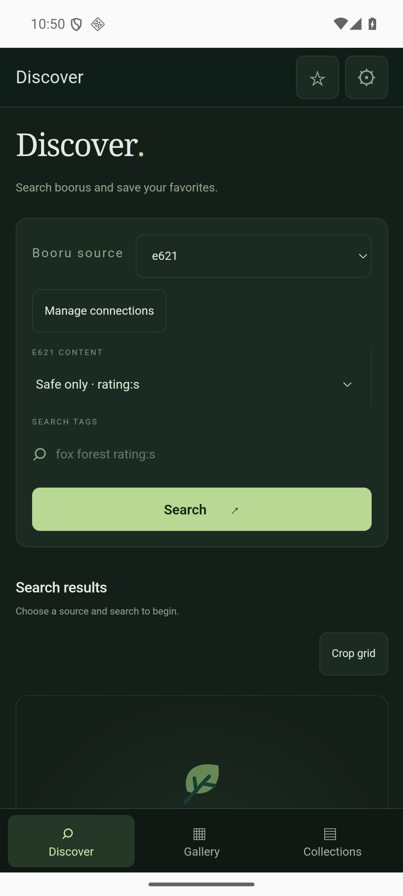
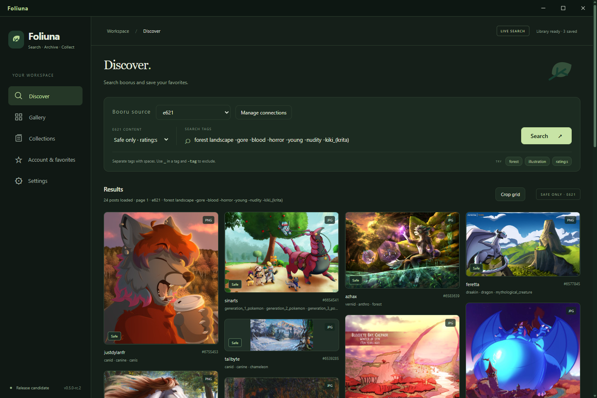
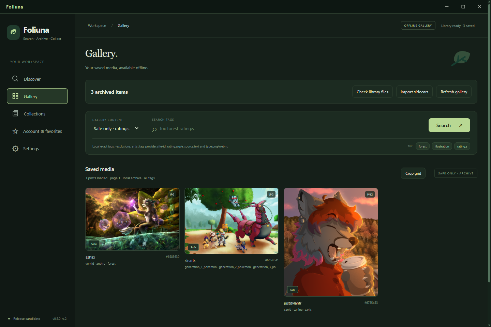
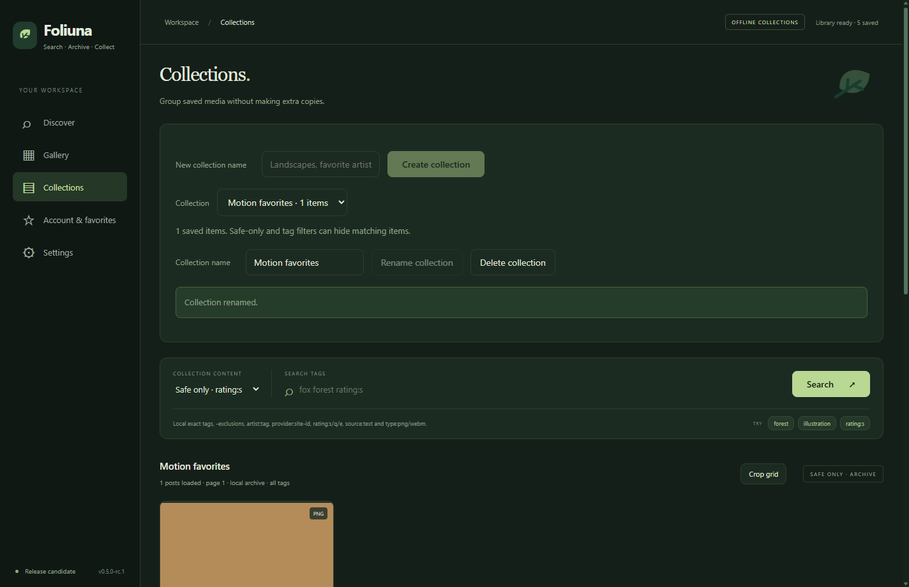

# Foliuna


A booru searcher, offline gallery and personal archive for Windows and Android. Find posts by tag, save originals with their context, and organize your own collections.

[Explore the website and interactive demo](https://JustyPixels.github.io/Foliuna/) · [Downloads](https://github.com/JustyPixels/Foliuna/releases) · [Questions and issues](https://github.com/JustyPixels/Foliuna/issues)

| Platform | Status | Download |
| --- | --- | --- |
| Windows 10/11 x64 | Unsigned 0.5.0-rc.1 candidate | [Installer and ZIP](https://github.com/JustyPixels/Foliuna/releases/tag/v0.5.0-rc.1) |
| Android 8.0+ | Debug-signed 0.1.0-preview.1 testing preview | [APK, checksum and verification](https://github.com/JustyPixels/Foliuna/releases/tag/android-v0.1.0-preview.1) |

Android uses a separate preview app and Android Keystore credentials. Export before uninstalling or changing signing identity: uninstalling removes private archives. Read the [Android installation, privacy and export guide](docs/ANDROID.md). No production signing identity or Google Play submission.









**Release candidate 0.5.0-rc.1:** Electron + React + TypeScript, multi-provider search/pagination/details with safe-only or all-ratings filtering, encrypted credentials, working thumbnails, sample/full-size image viewing, native archive-folder selection, explicit original downloads, SHA-256 deduplication, source snapshot history, categorized tags in SQLite, portable `.foliuna.json` sidecars, interrupted-save recovery, an offline gallery, named local collections with portable SHA-256 memberships, local search/thumbnail cache, validated sidecar restore, moved/missing-file checks, a local demo and automated tests. New searches run when submitted; optional infinite scrolling then loads one additional page at the end of the list. Built-ins: e621, Danbooru, Gelbooru, Rule34.xxx, Safebooru, AIBooru, Yande.re and Konachan. Custom Danbooru/Gelbooru JSON sites can be added in Settings. Safe-only mode is the default; see [connections and compatibility](docs/BOORUS.md).

**Windows downloads:** [GitHub Releases](https://github.com/JustyPixels/Foliuna/releases). Install the Setup executable, or extract the complete ZIP and open `Foliuna.exe`. This candidate is unsigned. See the [installation, backup and release guide](docs/RELEASE.md). Gallery and Collections work offline; browsing online previews still does not archive anything. See [the Collections guide](docs/COLLECTIONS.md) for creation, membership, safe deletion and portable recovery.

## Run on Windows

Install Node.js **24 LTS (24.18 or later in the 24.x line)** and npm. From this directory:

```powershell
npm ci
npm start
```

`npm start` typechecks and builds the local app, then launches Electron. No separate server or native SQLite build tools are required. SQLite uses Node's bundled `node:sqlite` in the main process. Keep the lockfile; the tested Electron release is pinned to 44.7.2.

`npm run build` only creates the app files; it does not open a window. To open an already-built app without rebuilding, run `node .\scripts\launch.mjs` from this directory. Keep the terminal open while using the app.

For a completely offline demonstration after installing dependencies:

```powershell
npm run demo
```

The demo has 30 fictional safe-rated posts, three original local SVG illustrations, two pages, and working tag filters/details. Try `forest`, `fox`, `wolf`, `deer`, or `fox -wolf`. Demo filtering supports exact tags, exclusions, `rating:s`, and `order:id_desc`; other booru operators work only in live mode. Demo never silently replaces a failed live request. Its IDs are fictional, so source opening, connection testing and original downloads are disabled. Encrypted credential saving/removal and folder selection can still be exercised in its separate profile.

Live access is read-only and may be restricted by the provider or local network. Rule34 requires a user API key and numeric ID; Gelbooru may require them. Other built-ins support anonymous reads. A 403 does not prove a key is required, and a key cannot bypass a site or network restriction. Source post links open in the default browser on an explicit click; arbitrary source strings remain plain text. Chromium may cache viewed images in its application profile. Retired e926 archive provenance and encrypted credential files are preserved, but no live API calls are made to e926 and its old key is not automatically reused for e621.

## Add your API key

1. Start live mode with `npm start` and open **Settings** in the sidebar.
2. On the provider website, generate an API key from your account/profile controls and enable API access if required.
3. Select **Settings → Booru connections → Connection**, enter that site’s username (Basic) or numeric user ID (Gelbooru/Rule34) and API key, then choose **Save credentials**. Do not enter your account password. These credentials apply to both safe-only and all-ratings searches.
4. Choose **Test connection**. This makes one paced safe-rated metadata request for the selected connection and reports the result. HTTP 401 suggests invalid credentials/API access; HTTP 403 may also indicate provider or network restrictions.
5. Use **Remove credentials** to stop Foliuna using that entry. This deletes the local encrypted file; revoke the key on the site to invalidate it everywhere.

The password field clears immediately on submit and never reloads a saved key. Only transient entry passes through the local UI to main. Main uses Electron's asynchronous safeStorage with Windows DPAPI; username and key are encrypted together in the profile, decrypted briefly for the exact configured HTTPS API. Basic credentials use Authorization headers; Gelbooru/Rule34 require API query parameters added only at dispatch. Keys never enter cache identities, logs, archive metadata, sidecars or CDN media requests. Unreadable entries report as locked; no silent anonymous fallback occurs.

Windows DPAPI and Android Keystore protect saved entries through their operating system. Foliuna must briefly decrypt a key to authenticate; this cannot protect against a compromised device or software acting with your user/app privileges. Both platforms refuse plaintext credential persistence. Archived artwork and portable metadata are separate ordinary files; Android keeps its originals in app-private storage until you export. See [Electron's security semantics](https://www.electronjs.org/docs/latest/api/safe-storage) and [Android Keystore](https://developer.android.com/privacy-and-security/keystore).

## Archive originals

1. In **Settings → Archive folder**, choose an archive folder. Foliuna checks safe file creation before accepting it, using hard links where available and an exclusive-copy fallback otherwise (including exFAT). Physical removable-drive power-loss behavior has not been verified; keep backups.
2. Search in live mode, open a post, and click **Download original**. Only that command starts an archive operation. Full-size viewing also fetches original image bytes, but does not save an archive asset. Cancel can stop an archive transfer; a finalization already underway finishes safely.
3. The app re-fetches the source snapshot, validates URL/type/size/signature and provider MD5 when supplied, streams the bytes, calculates SHA-256, and preserves the original plus sidecar and SQLite records.

Supported originals: JPEG, PNG, GIF, WebP, WebM, MP4 and SWF, up to 100 MiB. Known sizes are verified; APIs that omit size are streamed under the cap and the actual byte count is preserved. No automatic bulk downloads, executable/SVG originals, redirects, or signed-query media URLs are accepted. Video playback is on demand; SWFs use the bundled, isolated Ruffle player.

Identical SHA-256 bytes share one physical media file across sources. Each source retains its own categorized tags and capture history; repeated saves can add a new metadata snapshot without replacing previous snapshots. If a previously saved provider/post changes its original bytes, Foliuna preserves the earlier archive and reports that revision replacement is not yet supported.

Interrupted streams are discarded on recovery. A completed transfer with unfinished metadata publication is journaled and resumed without redownloading. If recovery fails, check free space and permissions, then choose the same folder in Settings to retry. Conflicting/corrupt media is not overwritten. These checks cover application interruption; they do not replace backups or guarantee recovery after hardware failure.

Library layout:

```text
chosen-folder/
  .foliuna/library.sqlite
  .foliuna/library.lock
  .foliuna/staging/                 # interrupted/in-progress transfers
  media/<sha256>.<extension>
  media/<sha256>.<extension>.foliuna.json
```

The database and sidecars remain with the library. Sidecars use schema version 1 and library-relative media filenames; see [the sidecar contract](docs/SIDECAR.md). Use Gallery → Import sidecars to restore a missing index from verified originals and sidecars. Corrupt/unknown-version databases are preserved rather than silently reset; see [the gallery guide](docs/GALLERY.md).

## Search

- Select **Discover → Booru source**. **Safe only** replaces rating terms with the site’s safe/general query and filters unexpected non-safe records from the response. **All ratings** passes your rating query through. Each app start defaults to safe-only.
- Space-separated tags: `fox forest rating:s`.
- Use underscores within one tag: `digital_media_(artwork)`; exclude with `-wolf`.
- The app controls page size at 24. `limit:` is rejected to keep numbered pagination consistent. Queries allow up to 40 terms and 512 characters.
- In **Settings → Browsing & display → Load results**, choose numbered pages (default) or infinite scrolling. Infinite scrolling appends one page at a time, ignores duplicate posts, stops on errors, and offers a manual Load more button. Loaded cards retain their position; offscreen images wait.
- Both browsing modes stop at page 750. The API does not provide a result total here; Next remains available after a full page, and an empty next page can occur. Previous returns to the prior results. Dynamic provider results can shift between searches.
- Changing the content filter clears displayed results. Page controls use the submitted query and filter, even if you have edited the next query in the input.

## Browsing, tags and media

- **Grid:** use the button above results, or Settings → Image grid, to choose a cropped, aligned grid or a flowing grid with original proportions. Details always preserve proportions. Grid layout and browsing mode persist across restarts, and the shared components/preferences also apply to Gallery and Collections.
- **Post navigation:** use Previous post / Next post inside details, or Left/Right arrows outside input/playback controls. At the last loaded post, Next loads the following page without closing details. It pauses while metadata is loading.
- **Images:** details start with Sample and preview fallback. Select Full size for the original image. Failures are visible with Retry image; failed originals never silently masquerade as a smaller sample.
- **Separate viewer:** Open media window opens a resizable, proportion-preserving window at the selected resolution. Its Fullscreen button or F11 toggles fullscreen; Escape leaves fullscreen. Closing it returns to the still-open details. This window has no app bridge.
- **Videos and GIFs:** grid cards mark video posts. WebM/MP4 details have playback controls and fetch video only when played (`preload=none`). Visible GIF cards and GIF details use the original animation. Media is bounded to 100 MiB; unsupported codecs report an error. The verified video is buffered before playback, so larger videos have a longer first-play delay; seeks reuse cached bytes rather than refetching each range.
- **Flash:** click Play Flash with Ruffle in details. The bundled runtime loads on a separate local origin with no app bridge, page-script access, remote network access or external navigation. Standard app pages keep their strict script policy. Ruffle compatibility varies; SWFs requiring external assets cannot fully work. Its local JS/WASM and licenses are included in the build, without runtime CDN dependencies. See [Ruffle's official integration/configuration documentation](https://github.com/ruffle-rs/ruffle/wiki/Using-Ruffle).
- **Autocomplete:** e621/Danbooru/Rule34 use cached site suggestions; other engines recommend tags observed in loaded results. Type at least two characters in the tag being edited. After a 650 ms pause, Foliuna requests up to eight site suggestions through the shared paced queue and caches the result in memory for up to 24 hours. Use Up/Down + Enter or click a suggestion; exclusions keep their `-` prefix. Metatags such as `rating:` are left alone. No bulk tag dump is fetched.
- **Tag actions:** click a categorized tag in details for Add to search bar, Exclude from search, or Favorite/Unfavorite. Editing the draft does not automatically search. Foliuna favorites, including artist tags, persist locally in the profile and are independent of site favorites.
- **Account & favorites (e621 account only):** after saving e621 credentials, open this sidebar panel to read account name, ID, membership level, join date, upload/favorite counts and site favorite tags (including artist tags). View my e621 favorite posts searches the signed-in account's favorites under the current safe/all filter. Select an artist/tag to browse it. Email, API keys, private account settings and unknown fields are not returned to the UI. This is a read-only view; it does not change site favorites or follow artists remotely.
- Scrollbars follow the app palette and retain keyboard/scroll-wheel behavior and system high-contrast support.

Viewed media resolves only registered post metadata through local protocol routes. Exact CDN hosts, redirects, MIME/signature, timeouts and sizes are checked in main; API credentials never reach those requests. Browsing, video playback, Flash playback and opening the media window do not create archive records.

## Offline gallery

1. Open **Gallery** in the sidebar. It reads only the selected local archive; no API key or internet connection is required. Newly archived originals already appear in the index; use Refresh gallery after saving.
2. Search exact tags or filters such as `fox -wolf artist:artist_name provider:e926 rating:s source:example.org type:png id:123`. All terms must match one captured source; matching sources sharing the same SHA-256 appear as one media card. Safe-only is the default. Gallery suggestions come from local tags.
3. Reuse the cropped/natural grid, numbered pages/infinite scrolling, detail navigation, tag favorites and resizable/fullscreen viewer. Details show the preserved capture and all provider/post identities for that asset. Local still images fit the saved original; no remote sample is required. GIF/video/Flash playback uses local bytes. Use Collections to group saved media without extra copies.
4. **Import sidecars** scans the selected folder for existing `.foliuna.json` files and their adjacent media. It verifies paths, schema, sizes, signatures, SHA-256, identities and categorized history before adding records. Input originals remain untouched; canonical files are never overwritten, valid destination sidecar histories are merged, and unchanged imports do not duplicate captures. Reports count verified sidecars, not newly created assets.
5. **Check library files** verifies indexed originals, finds renamed/moved matching media within the selected folder, recreates canonical copies and missing sidecars, and reports missing/corrupt/conflicting files. It keeps existing files and metadata. **Stop library task** stops between files; a file already being finalized can finish. Never unplug storage while a write is in progress.

If the site replaces a post’s bytes, the earlier capture remains in Gallery. Use a different archive folder to retain the new revision too; revision replacement is not automatic. A lost original stays searchable and may retain a cached thumbnail; viewing never silently redownloads it. See [GALLERY.md](docs/GALLERY.md) for grammar, import/recovery steps and limits.

## Local data

Normal profile: `%APPDATA%\Foliuna\`.
Demo profile: `%APPDATA%\Foliuna Demo\`.

Thumbnails are disposable derived PNG files under the selected library’s `.foliuna/thumbnails/`; their generation stays in the sandboxed renderer.

Profiles hold Chromium data, `preferences.json` (browsing mode, grid mode and local favorite tags), `library.json` with the selected folder, and per-provider `*.credentials.enc` files. Actual archive databases are under the selected library folder. A phase-1 profile database is left untouched; it is not silently moved or imported. Selected archive databases migrate non-destructively to schema version 3, and newer unknown schemas are refused.

Development and desktop tests can set `FOLIUNA_DATA_DIR` to isolate the profile. Packaged apps ignore these environment overrides; use explicit `--demo` and `--user-data-dir=<absolute-path>` launch arguments for an isolated demonstration. A library lock prevents concurrent writers across profiles; a stale lock from a stopped process can be reclaimed. Back up the entire selected library together, rather than copying only its database while the app is writing.

## Verify

```powershell
npm test          # deterministic unit, adapter, database, IPC and React tests
npm run build    # full TypeScript check and renderer/main/preload bundles
npm run test:e2e # build and exercise the actual Electron desktop app
npm run check    # unit/component tests, build, then desktop test
```

Archive tests stream bytes from a real local fixture HTTP server. They cover deduplication, source/tag/snapshot preservation, size/signature/checksum errors, cancellation, HTTP/redirect failures, recovery, locks and no-overwrite behavior. Credential/media tests cover validation, scoped headers, encrypted persistence, sanitized status and the bounded image route. Desktop tests additionally decode generated GIF/VP8 video fixtures, load/play a generated SWF in Ruffle, check cross-origin isolation, exercise fullscreen/resizing, persisted browsing preferences, autocomplete, tag actions and infinite scrolling. They also exercise actual Windows encryption, restart persistence/removal, folder selection, dialog focus, search, sandboxing, CSP, blocked navigation/popups and portrait/landscape sample/full-size image decoding and proportions. Credential desktop tracing is disabled. No separate browser download is needed. Screenshots are refreshed in `docs/screenshots/`. The offline desktop fixture rejects every API/CDN fetch and verifies gallery images, video, GIF/Flash, local suggestions, thumbnail persistence, restore/reconciliation and restart with zero attempts. Default tests never call the providers; opt-in live image verification is recorded in LOG.md.

Use [LOG.md](LOG.md) for actual verification results and limitations, [architecture](docs/ARCHITECTURE.md) for trust boundaries and the storage plan, [roadmap](docs/ROADMAP.md) for the next increments, and [AGENTS.md](AGENTS.md) for contributor instructions.

## Provider policy and security

All JSON calls run in main through one bounded queue shared by configured providers, with 1.1 seconds between request starts, a 15-second timeout, an 8 MiB response cap, no redirects, no automatic retries, and cooldowns on HTTP 429/503. Retry-After values are honored with a minimum 30-second pause. Authenticated requests identify the saved username in the application User-Agent; anonymous requests identify Foliuna 0.5.0-rc.1, maintainer JustyPixels and the GitHub Issues contact. Archive transfers are single-file, user initiated, credential-free, size bounded and limited to 120 seconds. Viewed media has a separate bounded loader: two transfers at once, a 60-second timeout, 8 MiB thumbnail/sample and 100 MiB original limits. Duplicate in-flight requests share one transfer; a five-minute memory cache is capped at 128 MiB. Byte-range requests reuse verified bytes. CDN 429/503 responses also pause subsequent transfers for at least 30 seconds. API JSON caching is bounded to 120 entries/32 MiB; search/details/account results live for one minute and tag prefixes for 24 hours. Saving/removing credentials clears those caches; archive snapshots always fetch fresh metadata. These measures reduce traffic, but cannot guarantee that a provider will never restrict access.

The UI loads from `foliuna://app`, with sandboxing, context isolation, Node integration disabled, CSP, denied permissions (except fullscreen from the owned viewer main frame), blocked navigation/popups and Chromium-initiated downloads, and sender-frame validation on every capability. Explicit original archiving and validated image fetching are performed in main. Remote sites are never embedded. The only permitted frame is the bundled Flash player at foliuna://player. Renderers load bytes only from local bundle/media routes; remote scripts/HTML, arbitrary filesystem/SQL access and general IPC methods are absent.

Primary references: [e621 API help](https://e621.net/help/api), [Electron security](https://www.electronjs.org/docs/latest/tutorial/security), [Electron protocol](https://www.electronjs.org/docs/latest/api/protocol), [Node SQLite](https://nodejs.org/api/sqlite.html). Policy details and live-access verification are recorded in the log.

This unsigned Windows release candidate includes NSIS/ZIP packaging, a leaf icon, hardened executable fuses, ASAR integrity checks and a Windows verification workflow. Certificate signing, automatic updates and configurable blacklists remain pending. No real API key was supplied during development, so authenticated live provider access remains unverified. It is independent of e621/e926.
